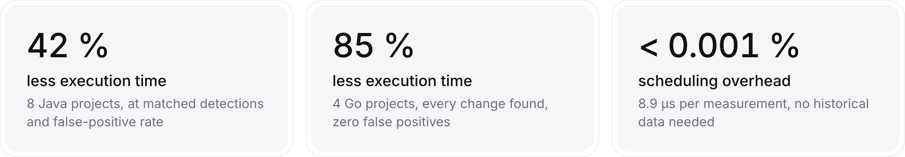
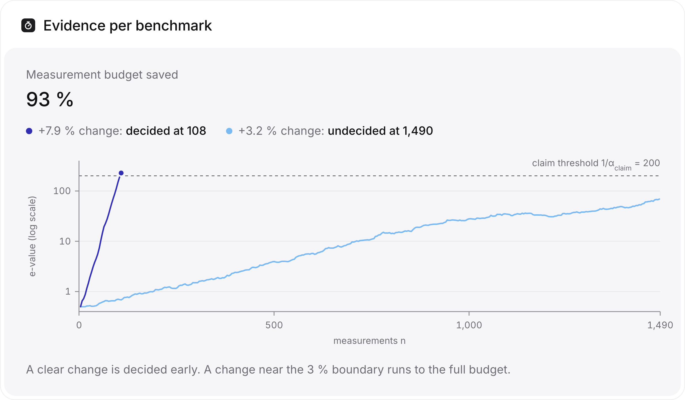
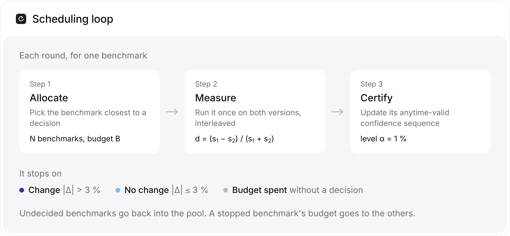

<div align="center">

# AdapBench

**Adaptive early-stopping and prioritization for microbenchmark suites in CI/CD**

[](#citation)
[](LICENSE)
[](pyproject.toml)
[](https://github.com/s3bastiankoch/adapbench/releases)

</div>

Microbenchmark suites in CI run every benchmark for a fixed number of repetitions, on every commit, whether or not anything changed. Most benchmarks don't change, so most of that compute confirms nothing.

AdapBench lets each benchmark stop as soon as the data decides. It tracks an **anytime-valid confidence sequence** per benchmark, so you may check after every measurement and stop whenever you like while the false-positive rate stays below α. It also **prioritizes** the benchmarks closest to a decision, so real changes surface early. It needs no tuning and no historical data.

<picture>
  <source media="(prefers-color-scheme: dark)" srcset="docs/results-dark.png">
  
</picture>

<picture>
  <source media="(prefers-color-scheme: dark)" srcset="docs/evidence-dark.png">
  
</picture>

## Quickstart

```bash
git clone https://github.com/s3bastiankoch/adapbench && cd adapbench
uv sync --extra dev            # or: python -m venv .venv && .venv/bin/pip install -e '.[dev]'
uv run python -m adapbench.scheduler
```

The smoke test needs no data. It schedules 23 synthetic benchmarks, 3 of them regressed:

```
decided 23 benchmarks in 2732 measurements (92% below the 34270 exhaustive); flagged as changed: ['reg0', 'reg1', 'reg2']
```

## How it works

<picture>
  <source media="(prefers-color-scheme: dark)" srcset="docs/how-it-works-dark.png">
  
</picture>

For the statistics (the band null, the e-process, the stopping rules) and open questions, see [docs/statistics.md](docs/statistics.md).

## Use it in your own pipeline

The scheduler is a standalone component. Implement one method for your benchmark harness and it plugs in unchanged:

```python
from adapbench.scheduler import Scheduler

class MyRunner:
    def measure(self, arm: str) -> float | None:
        """Run benchmark `arm` once on both versions; return the duet
        difference (s1 - s2) / (s1 + s2), or None when it can't run again."""
        ...

sched = Scheduler(benchmark_names, alpha=0.01, budget_per_arm=1490)
decisions, spent = sched.run(MyRunner())
# decisions[arm] in {"change", "no_change", "undecided"}
# sched.detected_at[arm] = measurements spent when the change was first flagged
```

`ReplayRunner` drives the same loop from recorded measurements. It is what the experiments use.

## Reproducing the paper

**1. Get the data.** The recorded traces are attached to the [GitHub release](https://github.com/s3bastiankoch/adapbench/releases):

```bash
scripts/fetch_data.sh          # downloads the v1.0.0 release archive (19 MB) into data/traces
```

| suite | content | source |
|---|---|---|
| `goduet` | 4 Go projects (prometheus/common, klauspost/compress, go-toml, zap), duet-recorded on GCP with RMIT ordering; the archive also holds an etcd corpus the paper excludes ([details](data/README.md)) | recorded for this paper |
| `tcp8` | 118 version-pair traces from 8 Java projects (bytebuddy, eclipse-collections, JCTools, jenetics, netty, okio, xodus, zipkin) | derived from the replication package of [Laaber et al., EMSE 2021](https://doi.org/10.1007/s10664-021-10037-x) (CC BY 4.0) |

Layout and provenance details are in [`data/README.md`](data/README.md).

**2. Run the experiments.** All seeds are fixed, so runs are deterministic. `goduet` takes seconds, `tcp8` a few minutes.

| paper result | script |
|---|---|
| Savings at matched recall (headline) | `experiments/scheduler_savings_pertrace.py tcp8 goduet` |
| False-positive validity (A/A) | `experiments/aa_scheduler.py`, `split_calibration.py`, `uniform_validity.py` |
| Detection latency vs. round-robin | `experiments/detection_latency.py` |
| Scheduler overhead | `experiments/scheduler_overhead.py` |
| Stopping-rule contributions | `experiments/fig_stop_rules.py` |

Recorded outputs of every run are in [`experiments/results/`](experiments/results).

## Repository layout

```
src/adapbench/       library: scheduler.py (online loop), cs.py (betting confidence sequence),
                     datasets.py, trace.py (loading and labelling)
experiments/         evaluation scripts and recorded results
scripts/             fetch_data.sh, pack_data.sh
tests/               unit tests (uv run pytest)
```

## Citation

If you use AdapBench or its dataset, please cite:

```bibtex
@inproceedings{koch2026adapbench,
  author    = {Koch, Sebastian and Heisterberg, Jonas and Japke, Nils and Bermbach, David},
  title     = {{AdapBench}: Adaptive Early-Stopping and Prioritization for Efficient
               Microbenchmarking in Cloud-based {CI/CD}},
  booktitle = {Proceedings of the 19th IEEE/ACM International Conference on
               Utility and Cloud Computing (UCC)},
  year      = {2026},
  publisher = {IEEE},
  note      = {To appear}
}
```

## License

Code: [MIT](LICENSE). The `tcp8` traces derive from the Laaber et al. replication package and stay under CC BY 4.0.

<sub>Scalable Software Systems Research Group, TU Berlin.</sub>
